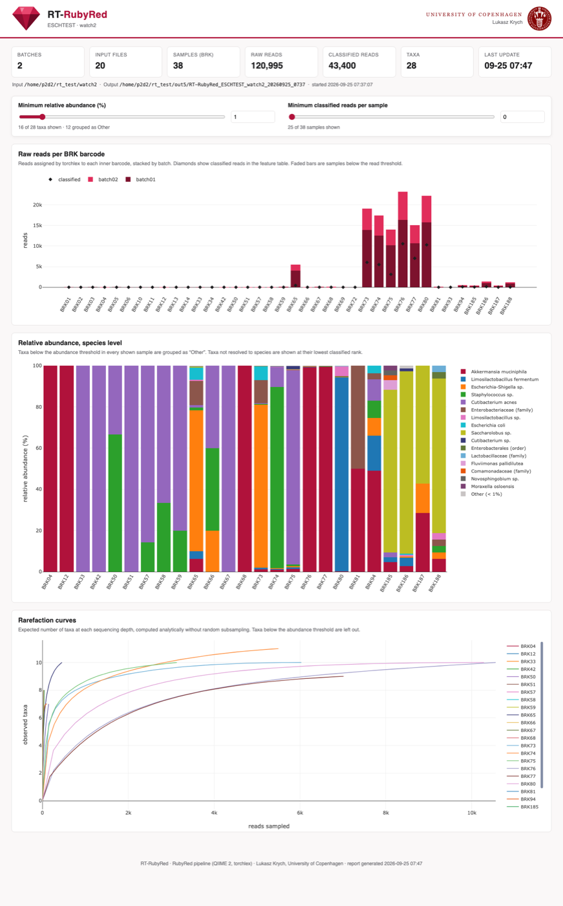
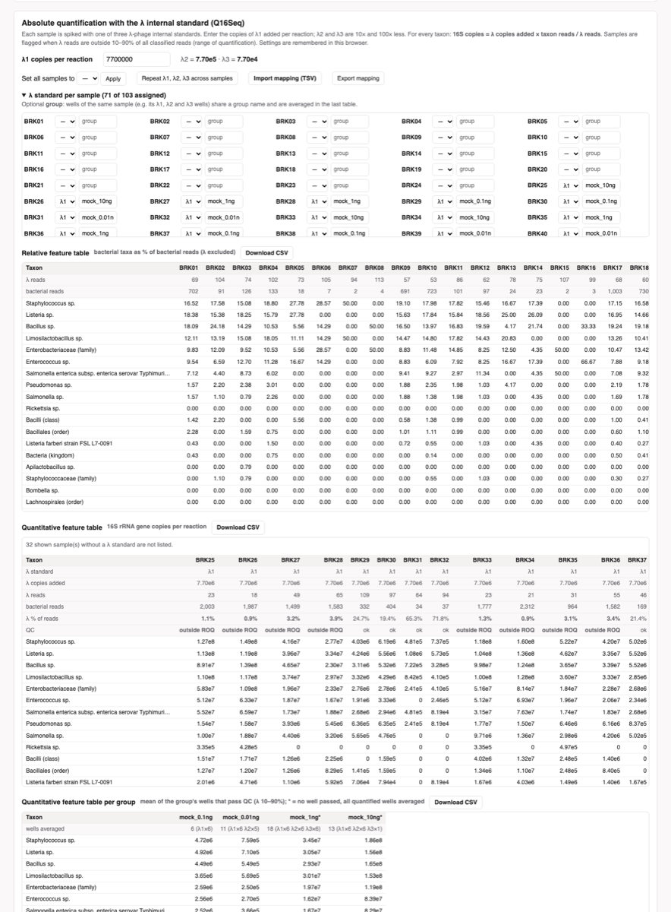

# Q16Seq

**Quantitative near full-length 16S rRNA gene sequencing on Oxford Nanopore, analysed in real time.**

```
     ▄▄▄▄▄▄▄           ▄▄▄       ▄▄▄▄▄       ▄▄▄▄▄▄
   ▄██████████▄      ▄████     ▄██▀▀▀██▄   ██████████▄
 ▄███▀▀    ▀███▄   ▄██████    ▄██▀   ▀▀▀  ████    ▀███      ▄▄▄▄        ▄▄▄▄ ▄▄▄
 ███▀       ▀███   █▀  ███    ███ ▄▄▄▄     ████▄▄▄▄       ███▀▀███▄   ███▀▀▀████
 ███         ███       ███    ████▀▀███▄    ▀▀███████▄   ███    ███  ███▀    ███
 ███▄   ▄▄  ▄███       ███    ███▀   ███  ▄▄▄     ▀███▄  ██████████  ███     ███
 ▀███▄▄ ▀██████▀       ███    ▀██▄   ███  ████▄   ▄███▀  ███    ▄▄▄  ███▄    ███
   ▀███████████▄       ███     ▀██▄▄▄██▀   ▀█████████▀   ▀███▄▄███▀   ███▄▄▄████
     ▀▀▀▀▀▀▀▀▀██▀      ▀▀▀       ▀▀▀▀▀       ▀▀▀▀▀▀▀        ▀▀▀▀▀       ▀▀▀▀ ███
                                                                             ███
                                                                             ▀▀▀

                                         ▄▄                                   ▄▄▄
███▀██▄ ▀▀▀██▀▀▀       ███▀██▄           ██              ███▀██▄              ███
███ ▄██    ██          ███ ▄██  ██  ███  ██▀▀██▄██▄  ██▀ ███ ▄██  ▄█▀▀█▄  ▄██▀███
██████▀    ██   ▀▀▀▀▀  ██████▀  ██  ███  ██  ███ ██▄▄█▀  ██████▀ ▄██▄▄███▄██  ███
███ ▀██▄   ██          ███ ▀██▄ ██▄ ███  ██  ██▀  ████   ███ ▀██▄▀██▄  ▄▄▀██  ███
▀▀▀  ▀▀▀   ▀▀          ▀▀▀  ▀▀▀  ▀▀▀▀▀▀  ▀▀▀▀▀▀   ███    ▀▀▀  ▀▀▀  ▀▀▀▀▀   ▀▀▀▀▀▀
                                                  ▀▀
```

Q16Seq spikes every sample with a synthetic λ-phage internal standard (λ-IS) before PCR. The λ-IS carries 16S primer sites, so it is amplified, barcoded and sequenced together with the bacterial 16S rRNA genes. Because the number of λ-IS copies added is known, read counts can be converted into **absolute 16S rRNA gene copies** per taxon.

This repository contains the Q16Seq analysis tool, built on **RT-RubyRed** (v1.1). RT-RubyRed runs the [RubyRed](https://github.com/reillyeo/RubyRed) pipeline while the nanopore sequencer is still running. It watches the folder MinKNOW writes `*.fastq.gz` files into, analyses each new batch of files as it arrives, and keeps a merged feature table and an interactive HTML report up to date for the whole run.

- Each batch is demultiplexed with torchlex (inner barcodes `BRK01`–`BRK192`) and classified with RubyRed against a species-level MIMt 16S classifier that includes the λ standard.
- The report has a **λ quantification panel**: enter the λ1 copy number and which standard each sample received, and it shows relative and absolute (copies per reaction) feature tables.

Reference: Wagner, Zimmermann *et al.* (2026), *Culture-based and quantitative Nanopore 16S rRNA gene sequencing insights into microbial quality and safety of plant-based meat alternatives* (submitted).



## Contents

- [How quantification works](#how-quantification-works)
- [Requirements](#requirements)
- [Installation](#installation)
- [Usage](#usage)
- [The HTML report](#the-html-report)
- [Output](#output)
- [Classifier](#classifier)
- [Resource limits](#resource-limits)
- [Testing](#testing)
- [Citation, license and author](#citation-license-and-author)

## How quantification works

Three λ-IS dilutions are used as internal standards: **λ1**, **λ2 = λ1/10** and **λ3 = λ1/100** copies per reaction. Each sample (or each technical replicate of a sample) is spiked with one of them.

For every taxon in a sample:

```
16S copies (taxon) = λ copies added × reads (taxon) / reads (λ standard)
```

- **Range of quantification (ROQ):** a sample is reliable when λ reads make up **10–90 %** of all classified reads. In that window each standard covers about ±1 order of magnitude around its own copy number. Together, λ1–λ3 cover about 10³–10⁷ copies at ~10,000 reads per sample. Samples outside the ROQ are flagged.
- **Groups:** wells of the same sample spiked with different standards (for example its λ1, λ2 and λ3 wells) can be given a common group name. The group value is the mean of the wells that pass the ROQ check. If none pass, all quantified wells are averaged and the group is marked with `*`.
- **Copy numbers** are 16S rRNA gene copies per PCR reaction, i.e. per volume of DNA extract added (5 µL in the Q16Seq protocol). Convert them to copies per gram or per mL of sample with your own extraction and dilution factors. Divide by the 16S copy number of a taxon for genome or cell equivalents.



The λ1 copy number comes from your own calibration of the λ-IS stock (for example against a mock community; see the Supplementary Material of the paper).

## Requirements

- Linux (tested on Ubuntu 22.04).
- A `qiime2` conda environment as used by RubyRed, containing `qiime` (tested with QIIME 2 2024.5, scikit-learn 1.4.2), `torchlex`, `cutadapt`, `chopper`, `vsearch`, `seqkit`, GNU `parallel` and `biom`, plus Python packages `pandas` and `psutil`.
- `systemd-run` (standard on Ubuntu) to enforce the RAM limit. Without it the tool still runs, but the RAM limit is not enforced.

## Installation

### 1. RubyRed, pinned to the version used by Q16Seq

> **Important:** newer RubyRed versions (from commit `d7f822d`, October 2026) trim every read to the 341F–1390R primer region and **discard reads without both primers**. The λ standard has no 341F site, so **all λ reads would be lost**. Q16Seq therefore uses RubyRed at commit `522dd3d`, which only filters reads by length (800–1600 bp). Q16Seq warns at start-up if the RubyRed script it is given trims primers.

```bash
mkdir -p ~/my_scripts && cd ~/my_scripts
git clone https://github.com/reillyeo/RubyRed.git RubyRed_Q16Seq
cd RubyRed_Q16Seq && git checkout 522dd3d
```

Then follow the [RubyRed instructions](https://github.com/reillyeo/RubyRed) to create its `qiime2` conda environment (with torchlex). Check that the environment has everything Q16Seq needs:

```bash
conda activate qiime2
for c in qiime torchlex cutadapt chopper vsearch seqkit parallel biom; do command -v $c >/dev/null && echo "ok  $c" || echo "MISSING  $c"; done
python -c "import pandas, psutil; print('ok  pandas, psutil')"
```

### 2. Q16Seq

```bash
cd ~/my_scripts
git clone https://github.com/krychu84/Q16Seq.git
chmod +x Q16Seq/Q16Seq
echo 'export PATH="$HOME/my_scripts/Q16Seq:$PATH"' >> ~/.bashrc
source ~/.bashrc
Q16Seq -v
```

The launcher activates the `qiime2` environment itself. It finds conda in `~/miniforge3`, `~/miniconda3` or `~/anaconda3`; for any other location, set `CONDA_BASE=/path/to/conda`.

Q16Seq uses `~/my_scripts/RubyRed_Q16Seq` when it exists, otherwise `~/my_scripts/RubyRed`. To use another RubyRed folder, set `RUBYRED_HOME=/path/to/RubyRed`.

### 3. Classifier with the λ standard

Download the three `MIMt_16s_311025_species_*.qza` files from the [latest release](https://github.com/krychu84/Q16Seq/releases/latest) and install them:

```bash
D=~/my_scripts/RubyRed_Q16Seq/resources/classifiers/MIMt_16s_311025_species
mkdir -p $D && mv ~/Downloads/MIMt_16s_311025_species_{classifier,seqs,tax}.qza $D/
cd $D && sha256sum -c ~/Downloads/SHA256SUMS --ignore-missing
```

At start-up Q16Seq prints `λ standard   in classifier (S__lambda_standard)`. See [Classifier](#classifier).

## Usage

Run it inside `tmux` or `screen`, so it keeps running if your SSH connection drops:

```bash
tmux new -s q16
Q16Seq -w /data/<experiment>/<sample>/<flowcell_run>/fastq_pass/barcodeNN
```

- Detach: `Ctrl-b` then `d`. Re-attach: `tmux attach -t q16`.
- **Stop and finalise:** `Ctrl-C`.

The λ settings can be given on the command line (they then pre-fill the report and are also written as tables), or entered later in the HTML report:

```bash
# λ1 = 7.7e6 copies per reaction; which standard each BRK sample received
Q16Seq -w .../fastq_pass/barcode94 --lambda1 7.7e6 --lambda-map lambda_map.tsv
```

`lambda_map.tsv` has one line per sample: sample, λ level (`1`/`2`/`3`, `L1`, `λ1` …) and an optional group. A header line is allowed:

```
sample	lambda	group
BRK01	L1	soy_burger
BRK02	L2	soy_burger
BRK03	L3	soy_burger
BRK04	L1	pea_mince
```

More examples:

```bash
# analyse a run that has finished (all files already there), then finalise after 6 minutes idle
Q16Seq -w .../fastq_pass/barcode94 --settle 0 --idle-stop 0.1

# report and Q16Seq tables from an existing RubyRed / RT-RubyRed feature table (no classification)
Q16Seq --from-table run_feature_table.tsv --lambda1 7.7e6 --lambda-map lambda_map.tsv

# continue a run that was stopped or crashed (same results folder)
Q16Seq -w .../fastq_pass/barcode94 --resume ~/Desktop/Q16Seq_<...>
```

| Option | Default | Description |
|---|---|---|
| `-w, --watch DIR` | | Folder with the incoming `*.fastq.gz` files |
| `--from-table TSV` | | Instead of watching: build report and Q16Seq tables from a feature table |
| `--lambda1 COPIES` | | λ1 copies per reaction (λ2 = λ1/10, λ3 = λ1/100) |
| `--lambda-map TSV` | | Sample → λ level (and group) |
| `-n, --name NAME` | from path | Run name |
| `-o, --outdir DIR` | `~/Desktop` | Where the results folder is created |
| `--resume DIR` | | Continue an earlier results folder |
| `--poll SEC` | 60 | Seconds between checks for new files |
| `--settle SEC` | 60 | Skip files modified in the last SEC seconds (still being written) |
| `--min-files N` | 1 | Minimum number of new files to start a batch |
| `--idle-stop HOURS` | 0 (never) | Finalise after HOURS without new files |
| `-R, --recursive` | off | Also look in sub-folders of the watch folder |
| `--cpu-frac F` | 0.5 | Share of CPU cores to use |
| `--mem-frac F` | 0.5 | Share of RAM to allow |
| `--classifier DIR` | species + λ classifier | Classifier folder; `original` = RubyRed's own default |
| `--subsample N` | no subsampling | RubyRed `-t` per batch |
| `--rubyred PATH` | `$RUBYRED_HOME/RubyRed` | RubyRed script |
| `--rubyred-args "..."` | | Extra RubyRed options (`-q`, `-l`, `-x` …) |
| `--barcodes FASTA` | RubyRed's | torchlex barcode file |

A batch takes about 2–6 minutes on a 32-core machine, mostly in RubyRed's sklearn classification step.

## The HTML report

A single self-contained HTML file (plotly.js is embedded, so it works offline), rebuilt after every batch.

- **Summary tiles:** batches, input files, samples, raw and classified reads, taxa.
- **Filters:** minimum relative abundance and minimum classified reads per sample (slider plus number box).
- **Raw reads per BRK barcode**, stacked by batch.
- **Relative abundance at species level**, including the λ standard (*lambda standard*).
- **Rarefaction curves** per sample (Hurlbert, analytical).
- **Absolute quantification with the λ internal standard (Q16Seq):**
  - λ1 copies per reaction (λ2 and λ3 are derived) and the λ standard per sample. Bulk buttons: set all, *Repeat λ1, λ2, λ3 across samples*, import/export a mapping TSV. An optional group name per sample.
  - **Relative feature table:** bacterial taxa as % of bacterial reads (λ excluded).
  - **Quantitative feature table:** 16S rRNA gene copies per reaction, with λ reads, λ % and a QC flag (outside the 10–90 % ROQ) per sample.
  - **Quantitative feature table per group:** mean of the group's wells that pass QC.
  - Every table can be downloaded as CSV. The settings are remembered in the browser.

All plots and tables follow the abundance filter (taxa below it are grouped as *Other*).

## Output

```
~/Desktop/Q16Seq_<run>_<dir>_<YYYYMMDD_HHMM>/
├── <run>_<dir>_<date>_feature_table.tsv        merged feature table (read counts, all batches)
├── <run>_<dir>_<date>_report.html              interactive report (single offline file)
├── <run>_<dir>_<date>_quantitative_table.tsv   16S copies per reaction  (with --lambda1 + --lambda-map)
├── <run>_<dir>_<date>_lambda_qc.tsv            λ level, λ reads, λ fraction, QC per sample  (idem)
├── input_file_index.tsv                        every input file analysed, with its batch
├── batch_stats.json                            raw reads per BRK barcode and per batch
├── RT-RubyRed.log                              what was shown in the terminal
├── run_meta.json                               run settings
├── fastq_demultiplexed/BRK01.fastq …           demultiplexed reads per sample (after Ctrl-C)
├── feature_tables/feature_table_batchNN.tsv
├── rep_seqs/<taxon>.fasta.gz                   classified reads per taxon, all batches
├── rubyred_batches/batchNN/                    RubyRed output per batch
└── logs/                                       full torchlex/RubyRed output per batch
```

## Classifier

Q16Seq uses `MIMt_16s_311025_species`: the MIMt 16S database (release 31-10-2025) as distributed with RubyRed, with cleaned species-level labels. It contains the **λ-IS reference sequence**, labelled `K__lambda_standard;…;S__lambda_standard`. Reads of the λ standard are classified as *lambda standard* (confidence 1.0, also with 5 % sequencing errors).

The species-level labels were made **without retraining** (`database/make_species_classifier.py`, details in [database/README.md](database/README.md)):

- synonyms and inconsistent lineages are unified (e.g. *Verrucomicrobiae* → *Verrucomicrobiia*);
- strain names are moved to an 8th rank, so the classifier adds up the probability of all strains of a species;
- species 16S cannot separate are merged (*A. massiliensis*/*A. biwaensis* → *A. muciniphila*; *Escherichia-Shigella*).

On 49,775 reads of a 16S run this raised species-level assignments from 8.3 % to 41.5 %, with no read becoming less specific.

## Resource limits

Q16Seq is meant to run on the sequencing computer during the run, so it limits itself: CPU pinned to half of the cores (`--cpu-frac`), RAM capped at 50 % with `systemd-run --scope` (`--mem-frac`), `nice 10` and `ionice -c2 -n7`. CPU and RAM use are shown every 30 s while a batch runs.

## Testing

`test/simulate_run.sh` copies fastq.gz files into a folder in batches, the way MinKNOW writes them:

```bash
# terminal 1: 10 files every 2 minutes
test/simulate_run.sh /path/to/fastq_pass/barcodeNN /tmp/q16_watch 10 120
# terminal 2
Q16Seq -w /tmp/q16_watch -n TEST -o /tmp/q16_out --poll 20 --settle 5
```

### Synthetic training data

`test/make_synthetic_run.py` simulates a complete Q16Seq run with known truth: **32 samples × 3 λ standards = 96 inner-barcoded wells** (BRK01–BRK96; sample *i* in BRK3*i*−2 … BRK3*i* with λ1, λ2, λ3).

- Total bacterial 16S copies per reaction are log-spaced from 10³ to 10⁷; each sample has a random community of 3–10 of 12 reference taxa (the eight ZymoBIOMICS bacteria plus *Pantoea agglomerans*, *Lactiplantibacillus plantarum*, *Serratia liquefaciens* and *Klebsiella terrigena*; 16S sequences from NCBI RefSeq, `test/synthetic_refs/`).
- The λ-IS read is the λ-phage region amplified by the Q16Seq IS-F/IS-R primers (1,344 bp with its 16S tails).
- About 10,000 reads per well, drawn in proportion to copies; ~2 % Nanopore-like errors, both read orientations, plus a few percent short fragments and reads without barcode.
- Output is a MinKNOW-like `fastq_pass/barcode01/*.fastq.gz` folder plus `truth_copies_per_reaction.tsv`, `truth_reads_per_well.tsv`, `samples.tsv` and `lambda_map.tsv`.

```bash
python test/make_synthetic_run.py -o synthetic_run          # ~1.07 million reads, ~1.5 GB, ~4 min
Q16Seq -w synthetic_run/fastq_pass/barcode01 -n SYNTHETIC --settle 0 --idle-stop 0.05 \
       --subsample 10000 --lambda1 7.7e6 --lambda-map synthetic_run/lambda_map.tsv
```

torchlex assigns the synthetic reads to the correct wells. With λ1 = 7.7 × 10⁶ copies, wells inside the 10–90 % λ range recover the true total 16S copy number to within ±4 % (median estimate/truth 0.995). Samples below ~10⁴ copies have no well inside the range, which is the lower limit of the assay.

To try the report and the Q16Seq tables on a finished analysis without running the classifier:

```bash
Q16Seq --from-table <run>_feature_table.tsv --lambda1 7.7e6 --lambda-map lambda_map.tsv
```

## Citation, license and author

- **Author:** Lukasz Krych, University of Copenhagen, Department of Food Science.
- Released under the [MIT License](LICENSE). If you use Q16Seq, please cite the Q16Seq paper, RubyRed, QIIME 2 and the MIMt database (see [CITATION.cff](CITATION.cff)).
- **Built on:** [RubyRed](https://github.com/reillyeo/RubyRed), [QIIME 2](https://qiime2.org), [torchlex](https://nanoporetech.com/resource-centre/torchlex-method-real-time-demultiplexing-barcoded-oxford-nanopore-reads), [scikit-learn](https://scikit-learn.org), [plotly.js](https://plotly.com/javascript/) (MIT, bundled in `assets/`).
- The University of Copenhagen seal in the report belongs to the University of Copenhagen.
